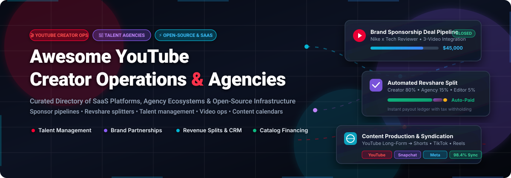

# 🚀 Awesome YouTube Creator Operations Agencies

  
  
  
  
  
  
  

  

---

### 📌 Curated Ecosystem of Creator Management Agencies, SaaS Operating Systems & Open-Source Infrastructure

> **Scale the Business Behind the Content:** A comprehensive directory tracking premier **SaaS platforms**, **creator management agencies**, and **self-hosted open-source software** built for **YouTube Creator Operations Agencies**. Empowering creators, talent managers, and operations teams to automate brand partnership pipelines, contract administration, revenue splits, content calendars, and multi-platform syndication without spreadsheet chaos.

`#YouTubeCreatorOps` `#CreatorEconomy` `#TalentManagement` `#BrandPartnerships` `#CreatorOperations` `#RevShare` `#OpenSourceCRM` `#VideoProductionOps`

---

## 📑 Table of Contents

- [📈 Sector Overview & Market Dynamics](#-sector-overview--market-dynamics)
- [🏢 SaaS Platforms & Creator Agencies](#-saas-platforms--creator-agencies)
- [🛠️ Open-Source GitHub Projects](#️-open-source-github-projects)
- [📦 CLI & NPM Developer Toolkits](#-cli--npm-developer-toolkits)
- [🏗️ Recommended Creator Operations Blueprint](#️-recommended-creator-operations-blueprint)
- [🤝 How to Contribute](#-how-to-contribute)
- [⭐ Star History](#-star-history)
- [☕ Support & Sponsorship](#-support--sponsorship)
- [📜 Disclaimer & License](#-disclaimer--license)

---

## 📈 Sector Overview & Market Dynamics

The global creator economy and YouTube creator operations agency ecosystem is estimated at **$250B – $280B in 2026** (projected to reach **$480B – $520B by 2030** at an annual CAGR of ~22.5%), propelled by soaring direct-to-creator brand budgets, multi-format video syndication, and private-equity catalog rollups.

### 🌐 Market Structure & Competition
- **Moderately Fragmented with Bimodal Distribution:** The creator operations landscape does not follow a pure winner-take-all monopoly. Instead, market power is distributed across two core tiers:
  1. **Consolidated Tier-1 Agencies & Capital Acquirers** (*Night Media, Viral Nation, Electrify Video Partners, Jellysmack, Spotter*): Concentrated at the top 1% of mega-creators (>1M+ subscribers), leveraging balance-sheet financing, catalog equity acquisitions, and high-touch enterprise talent representation.
  2. **High-Fragmentation Long-Tail & Boutique Firms:** Thousands of independent creator managers, boutique agencies, and solopreneur studio collectives managing mid-tier creators. Because agency commissions (15%–20%) and enterprise SaaS licensing eat significantly into operating margins, mid-tier creator teams increasingly migrate toward modular, self-hosted, and open-source operations stacks.
- **Rise of Creator Ops Automation:** Operations teams are rapidly replacing manual spreadsheet workflows with unified event-driven architectures—combining open-source databases (NocoDB, Baserow), contract signature engines (Documenso), and workflow engines (n8n, Activepieces) to automate deal flow from sponsor pitch to revenue split payout.

---

## 🏢 SaaS Platforms & Creator Agencies

The table below benchmarks category-leading SaaS operating platforms and creator talent management agencies. Entries are **sorted descending by estimated company size / market valuation**.

| 🏢 Company / Platform | 📊 Company Size / Valuation | 🎯 Core Operations & Agency Focus | 💰 Pricing (Starting Tier) | 🆓 Free Tier Limits / Free Trial |
| :--- | :--- | :--- | :--- | :--- |
| **[Spotter](https://spotter.com/)** | **~$1.7B Valuation** *(SoftBank Vision Fund 2; $940M+ deployed to creators)* | YouTube back-catalog licensing, upfront capital financing, AI-powered title/thumbnail ideation (Spotter Studio), and channel scaling analytics. | **10% – 30% revenue share** on licensed back-catalog ad revenue; standalone Spotter Studio AI software starts at **$49 / mo**. | **14-Day Free Trial:** Full access to Spotter Studio AI ideation, thumbnail brainstormer, and story engine for 1 channel; no credit card required. |
| **[Jellysmack](https://jellysmack.com/)** | **~$500M+ Valuation** *(SoftBank Vision Fund 2, $22M+ Series C; $500M JellyFi capital fund)* | AI-powered multi-platform video syndication (YouTube to Facebook, Snapchat, TikTok), catalog optimization, and creator financing. | **20% – 50% net revenue split** on syndicated platform ad revenues with zero upfront cash costs; enterprise syndication contracts start at **$5,000 / mo guarantee**. | **No free tier;** offers a free 1-on-1 channel syndication audit and multi-platform revenue projection report upon creator application (requires >100K YouTube subscribers). |
| **[Viral Nation](https://www.viralnation.com/)** | **~$250M – $350M Valuation** *(Eldridge-backed $100M round, ~$80M ARR, 800+ employees)* | 360-degree digital talent management, global influencer marketing campaigns, brand safety AI (*Viral Nation Secure*), and creator commerce. | Talent representation commission of **15% – 20% on gross brand deals & sponsorships**; enterprise software contracts start at **$2,500 / mo**; agency campaign retainers start at **$15,000 / campaign**. | **No free tier;** provides a complimentary talent qualification evaluation and brand safety scorecard audit for qualified creators (minimum 100K+ cross-platform followers). |
| **[Electrify Video Partners](https://electrify.video/)** | **~$185M+ Capital Raised** *(17Capital credit & equity, ~$30M ARR, portfolio includes Veritasium)* | YouTube channel equity acquisitions, growth capital investment, operational scaling, localized dubbing/translation, and merchandise IP. | Equity investment of **$1M – $10M per channel** in exchange for a significant minority or majority equity stake; operations funded through reinvestment of net channel profits. | **No free tier;** provides a comprehensive free financial valuation and channel exit appraisal for channels generating >$500K in annual net profit. |
| **[Night Media](https://www.nightmedia.com/)** | **~$150M – $200M Valuation** *(Top creator management firm representing MrBeast, Kai Cenat, Theo Von; $100M+ gross bookings)* | Elite digital talent management, YouTube strategy, consumer brand incubation (Feastables, MrBeast Burger), podcast production, and licensing. | Industry-standard **15% – 20% commission** on gross creator sponsorship agreements, brand endorsements, equity advisory, and licensing revenue. | **No free tier;** complimentary talent roster review and brand partnership audit upon qualification (>500K YouTube subscribers). |
| **[Whalar](https://whalar.com/)** | **~$120M – $150M Valuation** *(Global creator agency, acquired Sixteenth, ~$50M ARR)* | Creator talent representation, brand campaign strategy, proprietary creator tech (*The Lighthouse*), and creative video production. | Talent management commission of **15% – 20% on brand deals**; brand campaign management starts at **$10,000 / campaign retainer**. | **No free tier;** provides an introductory creator suitability consultation and portfolio match analysis for creators with active brand sponsorship traction. |
| **[The Outloud Group](https://outloudgroup.com/)** | **~$60M – $80M Valuation** *(Bootstrapped & profitable, ~$40M+ annual creator media billings)* | YouTube influencer marketing agency, dedicated creator campaign strategy, multi-video brand integrations, and talent relationship management. | Management fee of **15% – 20% on negotiated creator brand deals**; brand agency retainers start at **$5,000 / mo retainer** (plus media spend). | **No free tier;** offers a free channel sponsor audit and media kit rate card benchmarking session for eligible YouTube channels. |
| **[Semaphore](https://semaphore.com/)** | **~$40M – $60M Valuation** *(Pioneer in creator business operations, managing 300M+ monthly impressions)* | Creator accounting, multi-state tax compliance, entity formation (LLC/S-Corp), insurance, licensing contracts, and payroll for creator staff. | Bookkeeping & business management starts at **$750 / mo** (or 2% – 5% of gross creator revenue for 360-degree financial concierge services). | **No free tier;** offers a free 30-minute introductory tax & business entity structuring discovery call for creators earning >$100K/year. |
| **[Spinnr](https://spinnr.com/)** | **~$15M – $25M Valuation** *(Venture-backed creator operations & brand deal coordination platform)* | Creator operations workflow, sponsorship intake CRM, deliverable deadline tracking, auto-generated media kits, and invoicing. | Starts at **$49 / mo** *(Solo Creator tier for up to 3 active brand sponsorships; Agency tier starts at $199/mo)*. | **14-Day Free Trial:** Full access to sponsor pipeline CRM, contract generator, and 1 active campaign workflow; no credit card required. |
| **[Creator Sports Network](https://creatorsportsnetwork.com/)** | **~$10M – $15M Valuation** *(Boutique sports creator operations & athlete-creator agency)* | Sports creator management, athletic brand endorsements, stadium activations, athlete-creator crossover content, and YouTube channel operations. | Agency commission of **15% – 20% on sports sponsorship contracts** and commercial appearance fees. | **No free tier;** offers a complimentary channel audit and sports market sponsorship valuation for sports and fitness YouTube channels. |

---

## 🛠️ Open-Source GitHub Projects

The following open-source repositories provide the foundational building blocks for self-hosting your creator operations stack, automated sponsor CRMs, revshare ledgers, and video production pipelines. Repositories are **sorted descending by GitHub_Stars**.

- **[n8n-io/n8n](https://github.com/n8n-io/n8n)**   
  *Fair-code workflow automation platform.* The nervous system for creator operations: orchestrates multi-step workflows linking YouTube Data API, sponsor inquiry webhooks, Discord/Slack team notifications, contract status triggers, and automated payout notifications.

- **[nocodb/nocodb](https://github.com/nocodb/nocodb)**   
  *Open-source Airtable alternative.* Turns any PostgreSQL or MySQL database into a smart spreadsheet. Powers custom creator ops systems for video production schedules, sponsor CRM pipelines, asset vaults, and channel performance rollups.

- **[twentyhq/twenty](https://github.com/twentyhq/twenty)**   
  *Modern open-source CRM.* Built with modern TypeScript and GraphQL; perfectly adaptable for creator agencies tracking brand partnership stages, sponsorship contracts, talent rosters, and communication logs.

- **[TryGhost/Ghost](https://github.com/TryGhost/Ghost)**   
  *Independent creator publishing platform.* Native membership tiers, recurring subscription billing, and newsletter distribution enabling YouTube creators to build owned fan communities beyond platform algorithms.

- **[calcom/cal.com](https://github.com/calcom/cal.com)**   
  *Open-source scheduling infrastructure.* Eliminates email ping-pong for creator interview bookings, podcast guest scheduling, brand sponsor discovery calls, and agency roster syncs.

- **[frappe/erpnext](https://github.com/frappe/erpnext)**   
  *Full-featured enterprise resource planning (ERP).* Handles end-to-end agency financial accounting, creator payroll, contractor billing, project milestone tracking, and multi-currency international wire disbursements.

- **[directus/directus](https://github.com/directus/directus)**   
  *Real-time API and data management studio.* Bridges raw databases into an intuitive admin dashboard for managing high-resolution thumbnail graphics, video B-roll archives, sponsor asset vaults, and talent permissions.

- **[chatwoot/chatwoot](https://github.com/chatwoot/chatwoot)**   
  *Omnichannel customer messaging platform.* Consolidates inbound creator email inquiries, brand partnership pitches, and community DMs across Twitter, WhatsApp, and YouTube comments into a shared agency team inbox.

- **[mattermost/focalboard](https://github.com/mattermost/focalboard)**   
  *Open-source project management suite (Trello/Notion alternative).* Features Kanban boards, table views, and built-in **Content Calendar** templates optimized for tracking video production pipelines from scripting to upload.

- **[activepieces/activepieces](https://github.com/activepieces/activepieces)**   
  *Open-source Zapier alternative.* Lightweight TypeScript automation tool for connecting creator submission forms, publishing notifications, and automated YouTube video metadata archiving.

- **[knadh/listmonk](https://github.com/knadh/listmonk)**   
  *High-performance self-hosted newsletter manager.* Sends multi-million message promotional email blasts, video launch alerts, and community newsletters with zero per-subscriber SaaS fees.

- **[matomo-org/matomo](https://github.com/matomo-org/matomo)**   
  *Privacy-respecting web analytics platform.* Self-hosted Google Analytics alternative for measuring creator link-in-bio traffic, merchandise conversions, and sponsor campaign landing page attribution.

- **[documenso/documenso](https://github.com/documenso/documenso)**   
  *Open-source digital signature infrastructure.* Modern DocuSign alternative for signing creator sponsorship agreements, talent representation contracts, guest appearance waivers, and contractor NDAs.

- **[baptisteArno/typebot.io](https://github.com/baptisteArno/typebot.io)**   
  *Conversational form builder.* Embeddable intake forms for qualifying inbound brand partnership proposals, sponsor budget inquiries, and creator talent applications.

- **[invoiceninja/invoiceninja](https://github.com/invoiceninja/invoiceninja)**   
  *Open-source invoicing and billing platform.* Generates branded PDF invoices for brand sponsors, tracks payment milestones, supports online credit card/ACH payments, and logs contractor expense disbursements.

- **[baserow/baserow](https://github.com/baserow/baserow)**   
  *Open-source no-code database.* Unlimited row scalability for tracking creator channel rosters, sponsor contact directories, and editorial publishing schedules.

- **[civicrm/civicrm-core](https://github.com/civicrm/civicrm-core)**   
  *Open-source constituent relationship management.* Enterprise-tested CRM for tracking long-term sponsor relationships, donor patron history, and contact communications.

- **[Ratimon/openquok-monorepo](https://github.com/Ratimon/openquok-monorepo)**   
  *Social media scheduling and content publishing tool.* Hootsuite alternative for scheduling video cross-posts and managing multi-platform social promotion.

- **[Anton-Barinov/TropaTT](https://github.com/Anton-Barinov/TropaTT)**   
  *Self-hosted business operations system with AI agent MCP.* Complete operational dashboard with tasks, projects, client CRM, calendar, and 621 Model Context Protocol (MCP) tools for Claude Code, Cursor, and ChatGPT.

- **[Build4Build/YouTube-Virtual-Manager](https://github.com/Build4Build/YouTube-Virtual-Manager)**   
  *AI-powered YouTube channel optimizer.* Desktop application (Electron, React, TypeScript) that connects to YouTube Data API and OpenAI API to provide actionable video SEO and channel performance diagnostics.

- **[ReactorcoreGames/Reactorcores-Revshare-System](https://github.com/ReactorcoreGames/Reactorcores-Revshare-System)**   
  *Offline-first creative revenue share calculator.* Smart payout calculator with tier-based split percentages, team management, payout history, and guides on collaborative IP revenue distribution.

- **[Gamal-ElDeen/Revshare](https://github.com/Gamal-ElDeen/Revshare)**   
  *Automated partner revenue-sharing ledger.* Next.js and PostgreSQL system featuring n8n automation, monthly P&L snapshots, ownership profit distribution, management fee deductions, and immutable payment logging.

---

## 📦 CLI & NPM Developer Toolkits

- **[@bhaskarauthor/creator-ops](https://www.npmjs.com/package/@bhaskarauthor/creator-ops)**  
  *Ops OS for mid-tier creators.* Offline MVP core with zero runtime dependencies. Includes content calendar, sponsor CRM, asset vault, and analytics rollup designed for creators needing operational structure without recurring SaaS overhead.

- **[axis-crm](https://www.npmjs.com/package/axis-crm)**  
  *Git-based CRM for small creator teams & agencies.* Manages clients, projects, meetings, rates, and contracts as pure Markdown in a Git repository. Optimized for Obsidian with Dataview dashboards and AI-ready with bundled `CLAUDE.md`.

---

## 🏗️ Recommended Creator Operations Blueprint

```mermaid
flowchart LR
    A["🎬 Inbound Brand Deal / Sponsor Pitch"] --> B["📝 Typebot.io Intake Form"]
    B --> C["⚡ n8n / Activepieces Workflow"]
    C --> D["📊 Twenty CRM / NocoDB Deal Pipeline"]
    D --> E["✍️ Documenso Contract Signing"]
    E --> F["📅 Focalboard Video Production Calendar"]
    F --> G["🚀 YouTube Publishing & Syndication"]
    G --> H["💰 Revshare Ledger / Invoice Ninja Payouts"]
```

1. **Intake & Qualification:** Use **Typebot.io** to capture sponsor briefs and channel rate requirements.
2. **Deal CRM & Pipeline:** Track sponsorship stages, deliverable milestones, and brand contacts inside **Twenty CRM** or **NocoDB**.
3. **Contract Execution:** Generate and digitally sign sponsor agreements with **Documenso**.
4. **Editorial Scheduling:** Plan scripting, thumbnail approval, video edits, and sponsor integrations in **Focalboard**.
5. **Revshare & Billing:** Disburse creator, agency commission, and editor revenue cuts via **Invoice Ninja** or custom **Revshare** ledgers.

---

## 🤝 How to Contribute

Contributions are warmly welcomed! Help expand this creator operations ecosystem:

1. 🍴 **Fork the repository** on GitHub.
2. 🌿 **Create a new branch** (`git checkout -b feature/add-creator-tool`).
3. 📝 **Add your entry** adhering to the existing format (include name, URL, objective summary, pricing/Stars_Badge).
4. 📬 **Submit a Pull Request** with a short rationale of why the platform benefits creators and operations agencies.

Please ensure all submissions adhere to the [Awesome-Awesome-Awesome Guidelines](https://github.com/ishandutta2007/Awesome-Awesome-Awesome).

---

## ⭐ Star History

---

## ☕ Support & Sponsorship

Thank you so much for exploring and supporting **Awesome YouTube Creator Operations Agencies**! If you find this curated ecosystem valuable for your agency operations, creator business, or development projects:

- ⭐ **Star this repository** to improve its visibility for other creators and agency operators.
- 🍴 **Fork and share** the repo with your creator network, management team, and developer communities.
- ☕ **Buy me a coffee & sponsor ongoing curation:**

  

Your generous sponsorship directly fuels ongoing curation, software testing, and open-source infrastructure research!

---

## 📜 Disclaimer & License

- **Disclaimer:** This repository is an independent community-curated research directory and is not officially affiliated with, endorsed by, or sponsored by YouTube, LLC, Google LLC, or any of the listed agencies. YouTube is a registered trademark of Google LLC.
- **Compliance:** Creator operations workflows and tools must comply with platform terms of service, advertising disclosure standards (FTC guidelines), and relevant contract laws.
- **License:** Distributed under the [MIT License](file:///C:/Users/hp/Documents/Projects/Awesome-Youtube-Creator-Operations-Agencies/LICENSE).
